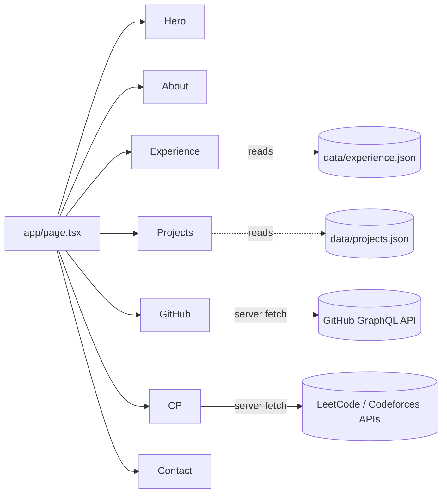

# Aditya Kumar — Portfolio

Personal developer portfolio built with Next.js 16 and a dark, cinematic editorial aesthetic. Live at **[adityakumar15.vercel.app](https://adityakumar15.vercel.app)**.


## Description

This is the source for my personal portfolio site — a single-page, section-based site that presents my projects, competitive programming stats, GitHub activity, and experience to recruiters and fellow developers. It's built to double as a live demonstration of front-end craft: a typographic poster hero, drafting-paper texture, a custom cursor, and restrained scroll-driven interactions, all on top of a dark, editorial visual system.

**Live demo:** [adityakumar15.vercel.app](https://adityakumar15.vercel.app)

## Table of Contents

- [Features](#features)
- [Tech Stack](#tech-stack)
- [Architecture](#architecture)
- [Prerequisites](#prerequisites)
- [Installation](#installation)
- [Configuration](#configuration)
- [Usage](#usage)
- [Project Structure](#project-structure)
- [Content Management](#content-management)
- [Deployment](#deployment)
- [Roadmap](#roadmap)
- [License](#license)
- [Acknowledgments](#acknowledgments)
- [Contact](#contact)

## Features

- **Live GitHub stats** — contribution calendar, streaks, and commit counts fetched server-side for `AdityaKumar1511`, with a saved snapshot fallback
- **Live competitive programming stats** — LeetCode (`Adi_2007`) and Codeforces (`aditya.kumar00706`) solve counts, ranks, and contest ratings, with offline/cached labels
- **Custom cursor** and GSAP-powered scroll interactions throughout
- **Section-based single-page layout** — Hero, About, Projects, Experience, GitHub, LeetCode, Contact
- **Content-as-data** — projects, bio, experience, and fallback stats are driven by JSON files in `data/`
- **Resume download** served at `/resume.pdf` (from `public/resume.pdf`)
- Fully responsive, dark editorial theme with a consistent CSS custom-property color system

## Tech Stack

| Category | Technology |
|---|---|
| Framework | [Next.js 16](https://nextjs.org) (App Router) |
| UI | [React 19](https://react.dev) |
| Language | TypeScript |
| Styling | Tailwind CSS 4, custom CSS variables |
| Animation | [GSAP](https://gsap.com/) + `@gsap/react`, Framer Motion |
| Icons | lucide-react |
| Fonts | Bricolage Grotesque / Switzer / Martian Mono |
| Hosting | Vercel |

## Architecture

This is a single Next.js App Router app — no separate backend. Dynamic content (GitHub, LeetCode, Codeforces stats) is fetched **server-side** in `lib/github.ts` and `lib/cp.ts` and cached for one hour. The GitHub request uses a server-only `GITHUB_TOKEN`; CP requests use the public APIs and fall back to saved snapshot values if a request fails.



Key decisions: content that changes often (projects, experience, fallback stats) lives in `data/*.json` rather than JSX. Third-party stats are fetched server-side and cached with `unstable_cache`, keeping API tokens private and avoiding a loading flash. The browser only reads a localStorage snapshot when the server has no live data.

## Prerequisites

- Node.js **20.9+** (required by Next.js 16)
- npm (or yarn / pnpm / bun — any Node package manager works)

## Installation

```bash
git clone https://github.com/AdityaKumar1511/portfolio_.git
cd portfolio_
npm install
```

## Configuration

Create a `.env.local` file (or set the variable in Vercel) with a GitHub token:

```bash
GITHUB_TOKEN=ghp_your_token_here
```

The token only needs `read:user` access. It is read exclusively on the server in `lib/github.ts`. Without it, the GitHub section shows the saved snapshot from `data/githubDefaults.json`.

If you fork this for your own use, update the usernames in one place:

| File | Variable | Purpose |
|---|---|---|
| `data/meta.json` | `githubUsername` | GitHub username for contribution stats |
| `data/meta.json` | `leetcodeUsername` | LeetCode username for solve/contest stats |
| `data/meta.json` | `codeforcesUsername` | Codeforces handle for rating/rank stats |
| `data/meta.json` | — | Name, tagline, role, socials, resume path shown across the site |

## Usage

```bash
npm run dev
```

Open [http://localhost:3000](http://localhost:3000) to view the site. The page hot-reloads on edits to `app/page.tsx` or any component.

```bash
npm run build   # production build
npm run start   # serve the production build
npm run lint    # run ESLint
```

## Project Structure

```
portfolio_/
├── app/
│   ├── layout.tsx        # Root layout, fonts, metadata/OG tags
│   ├── page.tsx           # Assembles all page sections
│   └── globals.css        # Design tokens (dark theme CSS variables) + base styles
├── components/
│   ├── Hero.tsx            # Landing section
│   ├── About.tsx           # Bio section
│   ├── Experience.tsx      # Achievements/experience list
│   ├── Projects.tsx        # Project cards, reads data/projects.json
│   ├── GitHub.tsx          # GitHub contribution stats + snapshot fallback
│   ├── CP.tsx              # LeetCode + Codeforces stats
│   ├── Contact.tsx          # Contact section
│   ├── CustomCursor.tsx / FadeIn.tsx / ArrowIcon.tsx
├── data/
│   ├── meta.json            # Name, tagline, socials, resume path, usernames
│   ├── projects.json        # Project list (name, tech, links, impact)
│   ├── cpDefaults.json      # Saved CP snapshot used when APIs fail
│   ├── githubDefaults.json  # Saved GitHub snapshot and section copy
│   └── experience.json      # Achievements/experience rows
├── lib/
│   ├── github.ts            # Server-only GitHub GraphQL fetch + validation
│   └── cp.ts                # Server-only LeetCode/Codeforces fetch
└── public/                  # Static assets (resume.pdf, profile.png, robots.txt)
```

## Content Management

To update the site's content without touching component code, edit:
- **Projects** → `data/projects.json` (order controls display order)
- **Experience / achievements rows** → `data/experience.json`
- **Fallback CP stats** → `data/cpDefaults.json`
- **Fallback GitHub stats** → `data/githubDefaults.json`
- **Bio / socials / resume link / usernames** → `data/meta.json`

## Deployment

Deployed on **Vercel**, auto-building from the `main` branch. To deploy your own copy:

```bash
npm i -g vercel
vercel
```

Or connect the repo directly at [vercel.com/new](https://vercel.com/new). Add `GITHUB_TOKEN` to the project's environment variables for live GitHub data; otherwise the saved snapshot is used.

## Roadmap

- [x] Add `og:image`, canonical metadata, and `sitemap.ts`
- [x] Add custom `not-found`, `error`, and `loading` pages
- [x] Remove unused dependencies and dead utility components
- [ ] Move to a custom domain

## License

MIT — see [LICENSE](./LICENSE).

## Acknowledgments

- [Next.js](https://nextjs.org) — application framework
- [GSAP](https://gsap.com/) — scroll and motion animation
- [Bricolage Grotesque](https://fonts.google.com/specimen/Bricolage+Grotesque), [Switzer](https://www.fontshare.com/fonts/switzer), and [Martian Mono](https://fonts.google.com/specimen/Martian+Mono) — typography
- [Tailwind CSS](https://tailwindcss.com/) — styling

## Contact

**Aditya Kumar**
[GitHub](https://github.com/AdityaKumar1511) · [LinkedIn](https://linkedin.com/in/aditya-kumar-57a988374/) · aditya.kumar00706@gmail.com
